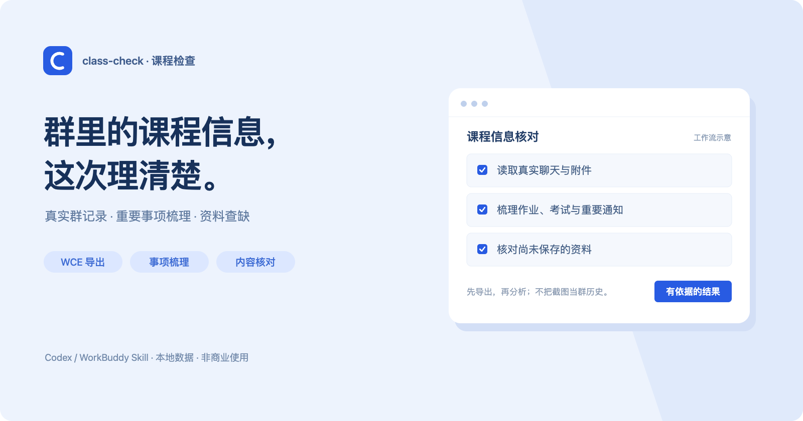

<p align="center">
  
</p>

# class-check · 课程检查

[项目展示](https://julianchen-ai.github.io/class-check/) · [下载源码](https://github.com/JulianChen-AI/class-check/archive/refs/heads/main.zip) · [完整 Skill](SKILL.md)

**群里的课程信息，这次理清楚。**

给 Codex、WorkBuddy 一套从微信记录到资料清单的处理流程：需要时先准备 WCE，再导出、阅读和核对，最后给你一份有依据的梳理。

这是 **Agent Skill**，不是独立聊天软件，也不是网页上传分析工具。适合整理课程群或比赛项目群；聊天、密钥和课程文件无需上传到项目展示页。封面为工作流示意，不是已经发布的 App 界面。

**公开源码，仅限非商业使用。商用须取得作者事先书面授权。** 详见 [LICENSE](LICENSE)。

## 可以做什么

- **梳理重要事项：**作业截止、考试范围、展示排期、签到要求；比赛项目则整理赛程、交付物、分工和会议决策。
- **读记录，也读附件：**不把一张截图当作群历史，重要结论保留通知日期和附件依据。
- **按内容找缺漏：**附件改名或多出 `(1)` 仍能识别；同名但内容不同，会提示版本差异。
- **给出能用的报告：**重要事项在前，基本信息用表格，缺少资料列名称、用途、发送日期及实际可用链接。

## 从群聊到结果

```text
群名／群截图 ＋ 本地资料目录
    ↓
准备 WCE → 首次权限与本地密钥配置 → 导出指定群
    ↓
读取真实聊天、引用与附件正文
    ↓
梳理重要事项 ＋ 按内容核对本地资料
    ↓
事项、基本信息、缺少资料、来源与覆盖范围
```

已有可用 WCE 或档案时优先复用。缺少 WCE 时，Agent 读取其官方安装说明，按授权下载到 **Skill 目录外** 并准备环境；有明显下载/构建成本而尚未授权时先确认。首次配置只把必须本人完成的权限和密钥导入交给用户，完成后继续原任务，不要求用户手工整理 JSON。

WCE 当前的新机源码安装面向 Apple Silicon、macOS 13+、原生 Python 3.11；以其当前官方文档为准。没有微信连接器，不等于没有可用的本机导出入口。

## 安装与使用

宿主需能读取本地文件、执行 Python 工具。将本仓库放入对应的 Skill 目录。**目标目录已存在时先检查和备份，不要直接覆盖。**

### Codex

```bash
git clone https://github.com/JulianChen-AI/class-check.git ~/.codex/skills/class-check
```

### WorkBuddy

```bash
git clone https://github.com/JulianChen-AI/class-check.git ~/.workbuddy/skills/class-check
```

让宿主重新读取 Skill，提供群名／截图和目标资料目录，然后说：

> 用 class-check 梳理这门课或比赛项目。需要时先引导安装和配置 WCE，导出真实群记录，再整理重要事项、基本信息，并核对本地资料缺漏。

现成档案可以复用，但不是用户必须提前准备的输入。截图通常用于识别群或指定报告样式；只有你明确要求“只看截图”，才降级为局部截图整理。

详细流程见 [WCE 接入说明](references/local-wechat-project.md)，输出结构见 [报告格式](references/report-format.md)。

## 技术结构

```text
Codex / WorkBuddy
    └─ class-check Skill：组织流程、阅读证据、生成报告
        ├─ WCE（外部）：安装、配置、导出真实群记录
        ├─ prepare-check.py：检查已有来源与下一步
        ├─ compare-attachments.py：附件身份与内容核对
        └─ ocr-image.swift：必要时在本地识别截图文字
```

- **主指令：**[SKILL.md](SKILL.md)。
- **宿主显示信息：**[agents/openai.yaml](agents/openai.yaml)。
- **静态项目展示：**[docs/index.html](docs/index.html)，无构建依赖、无聊天上传入口。

### 独立运行辅助脚本

Python 辅助脚本使用标准库，需要 Python 3.9+。

```bash
# 检查已有来源、WCE 准备情况和下一步
python3 scripts/prepare-check.py --group-name '精确群名'

# 也可校验已有档案
python3 scripts/prepare-check.py --archive /path/to/archive/chat.json

# 核对群附件与本地目录
python3 scripts/compare-attachments.py --archive /path/to/archive/chat.json --course-dir /path/to/course
```

脚本输出 JSON，不写入聊天档案或课程目录。消息 MD5＋字节数用于确认附件身份，SHA-256 用于内容比较。macOS 且已有 Swift 时，可选用系统 Vision 本地 OCR 识别截图文字；OCR 仍不是完整群历史。

## 当前状态与边界

已实现 WCE 准备、首次配置、导出和分析的流程指引，以及来源预检、附件核对和可选的本地 OCR。预检和文件核对已有离线行为回归：

```bash
python3 tests/test_prepare.py
```

干净 Mac 首次安装及不同宿主模型的实际执行效果仍需实机验证。Skill 不控制宿主模型，不因预检通过就宣称内容已读或任务完成。

- 本机导出不保证覆盖手机全部历史；缺失媒体、不可读附件和冲突会单独说明。
- 默认只读分析，不自动补拷、删除、覆盖课件，不发消息、邮件或提醒。
- 仅处理有权处理的聊天与文件；密钥在本地界面导入，不粘贴到对话。
- 缺少目录或未运行核对时明确写“未执行”，不冒充“无缺漏”。

## 来源与许可

聊天导出使用 [WCE · 微信全导](https://github.com/JulianChen-AI/wmr)（仓库名 `wmr`）。WCE 不内嵌在 Skill 中，按授权在外部安装和调用；其自身代码与依赖遵守各自许可。

本项目采用 [非商业许可证](LICENSE)：允许非商业学习、教学、研究及遵守许可的修改和再分发；**商业使用须取得作者事先书面授权。** 本许可不授权课程资料、聊天记录或用户数据的使用。
